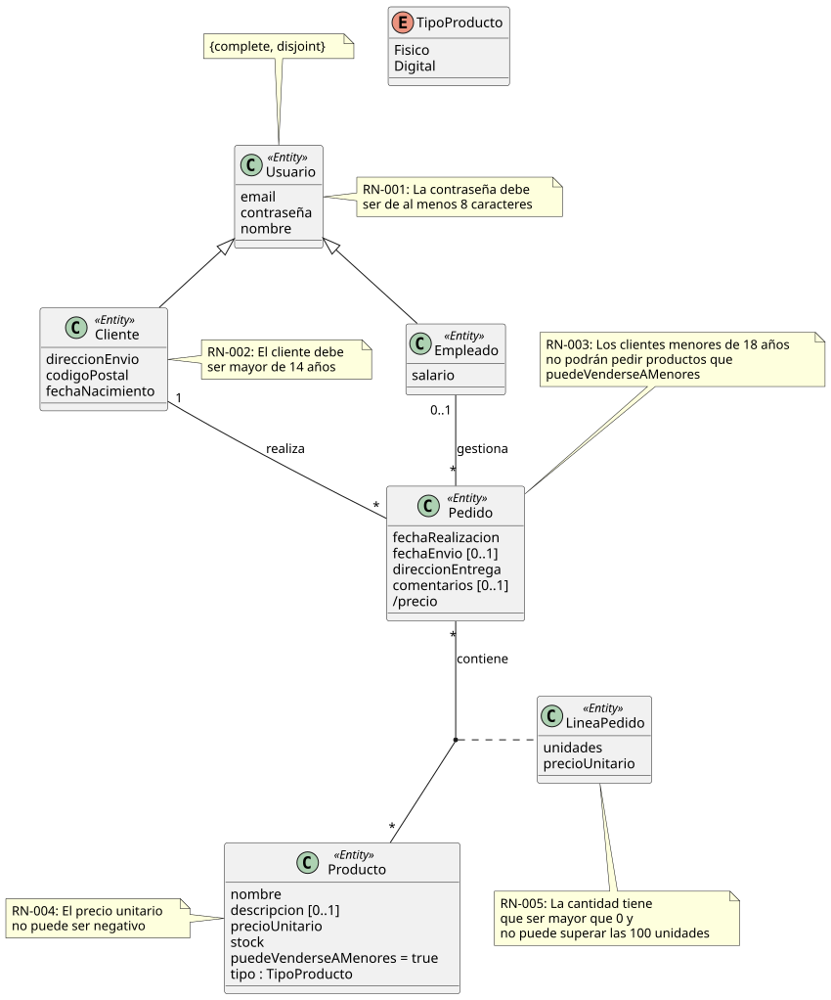

# Enunciado Evaluación Individual de Laboratorio - Modelo B1

**Si usted entrega sin haber sido verificada su identidad no podrá ser evaluado.**

## Tienda Online

Partiendo de la `tiendaOnline` vista durante los laboratorios descrita en el modelado conceptual siguiente:



Las tablas y datos de prueba iniciales se encuentran en los ficheros `0.creacionTablas.sql` y `0.poblarBd.sql`.

Realice los siguientes ejercicios:

### 1. Creación de tabla. 3 puntos

Se desea poder mostrar varias imágenes de cada producto. Además, se debe especificar una url para guardar la ruta de la imagen en el servidor (máximo 255 caracteres), que no puede ser nula. Se debe indicar también cuál de esas fotos es la "principal" para mostrar en el catálogo general. Para cada imagen necesitamos conocer la fecha de subida que puede ser opcional. Por último, hay que asegurar que si un producto cambia su `id`, las imágenes se actualicen automáticamente, pero si el producto se elimina, las imágenes también deben desaparecer de la base de datos.

### 2. Consulta. 3 puntos

Escribe una consulta SQL que devuelva el nombre del producto y el número total de imágenes que tiene asociadas cada uno, incluyendo solo aquellos productos que tienen menos de tres fotos (0, 1 y 2 fotos) y ordenando el resultado de menor a mayor cantidad de fotos.

### 3. Trigger. 4 puntos

Se ha definido la siguiente regla de negocio: "Un producto no puede tener más de 5 fotos en total". Crear un trigger que se ejecute antes de insertar una nueva imagen y muestre un mensaje por pantalla en caso de no cumplirse.

Además, si la nueva foto viene marcada como "principal", se debe asegurar que sea la única. Para ello, el trigger debe modificar las fotos anteriores de ese producto para que dejen de ser principales antes de guardar la nueva.

### NOTA. Avisar a profesor ANTES de realizar la entrega

Antes de realizar la entrega, levante la mano y muestre su DNI o similar al profesor del aula para la verificación de su identidad.

Si ha llegado al límite de tiempo, el sistema realizará una entrega automática, espere al profesor a que verifique su identidad.

**Si su identidad no ha sido verificada no podrá ser evaluado.**

Borre los archivos de su solución y ejecute:

```sql
DROP TABLE IF EXISTS Imagenes;
```
